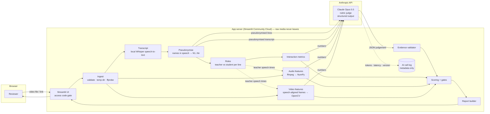
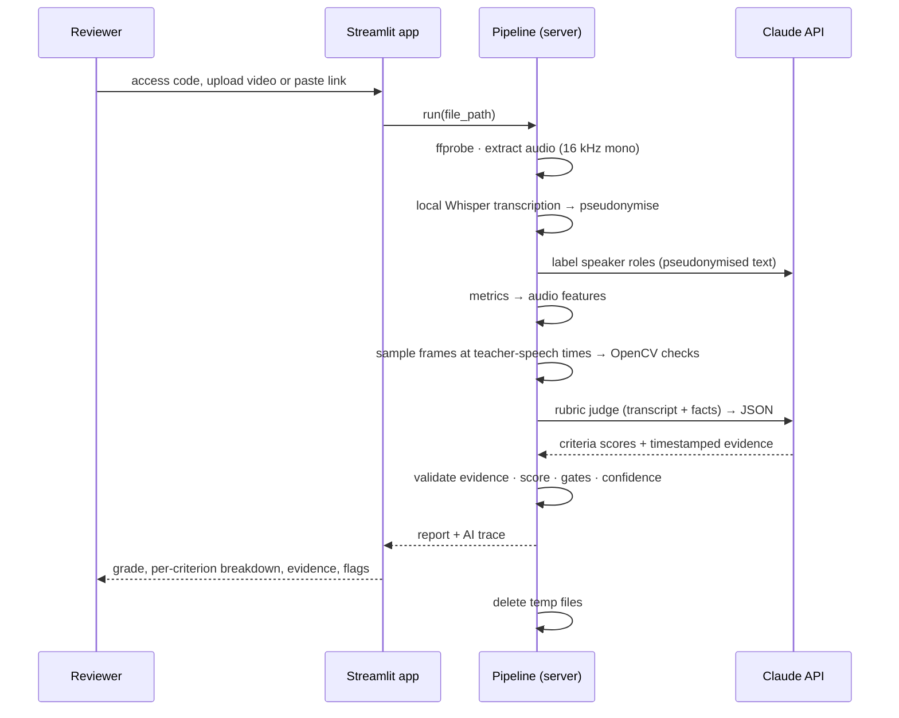

# ClassLens — High-Level Design

AI-assisted quality assessment for recorded online chess classes (8x8). Upload a class recording → get a grade (Poor / Average / Good / Excellent) with specific, timestamped observations.

Status: design v1.1 · 2026-10-23 (video checks built) · implementation follows this document; deviations get logged in `ai-logs/DECISIONS.md`. Code-level detail (every file, class and function): [LLD.md](LLD.md).

---

## 1. Problem and success criteria

| Requirement (from challenge brief) | How this design meets it |
|---|---|
| Accept a new recording (upload or link) | Streamlit upload of the class video (mp4, mov, mkv, webm) or a Google Drive / direct link. No transcript is expected: it is generated on the server from the video's audio |
| Classify as Poor / Average / Good / Excellent | Weighted rubric score (0–100) → grade bands calibrated on the labelled set |
| Explain with specific observations, not generic statements | Every observation carries a timestamp + quote or a measured number; ungrounded LLM claims are dropped by a validator |
| Genuinely process an unseen recording | Full pipeline runs on the input: transcript, audio, video frames, LLM judgement |
| Keep recordings confidential | Video and audio never leave the server; only pseudonymised transcript text + numeric facts reach the LLM API |
| Hosted link, README, AI interaction history, ≤300-word note | Streamlit Community Cloud app, GitHub repo, `ai-logs/` with redacted sessions |

Evaluation weights to optimise for: assessment quality 35%, problem-solving and use of AI 30%, working app and code quality 25%, clarity 10%.

---

## 2. What the data tells us

### 2.1 Dataset

- 12 Zoom cloud recordings: 10 labelled (2 each: Excellent, Good, Average, Weak, Known-quality-issue) + 2 unlabelled demos (English, Malayalam).
- 1080p, 25 fps, H.264 + AAC; 38–89 min; 54–340 MB each (1.7 GB total).
- Zoom **speaker view**: the active speaker fills the frame; during screen share (chessboard on a web board) the speaker appears as a thumbnail top-right next to the "8x8" logo.
- Each recording has a Zoom-generated WebVTT transcript with **speaker labels** (`Name: text`). Labels include device names ("…'s iPhone", "user") and `Audio shared by <teacher>` cues (computer audio, e.g. a video being played).
- Children are identifiable on camera → strongest privacy constraint in the design.

### 2.2 What reviewers reward and penalise (feedbacks.pdf → rubric)

| Theme in reviewer feedback | Mentioned for | Becomes criterion |
|---|---|---|
| Rapport building, proper intro, time for new joiners to introduce themselves | Excellent (+), Weak / Quality-issue (−) | C1 Opening and rapport |
| Asks questions individually, considers everyone, one-to-one interaction | Excellent, Good, Average (+) | C2 Individual engagement |
| Energetic, pleasant, happy communication | Good, Average, Weak, Quality-issue (−) | C3 Tone and energy |
| Proper conclusion, topic-related videos, structure (not jumping straight into revision) | Excellent (+), Weak (−) | C4 Lesson flow and closure |
| Homework given / "should give HWs" | All tiers | C5 Homework |
| 8x8 branded background, camera on, face visible, lighting | All tiers | C6 Teacher presence and setup |
| Repeated quality/connectivity issues | Quality-issue (−) | C7 Technical delivery |

### 2.3 First-pass signal check on transcripts

Quick exploratory script over the 10 labelled transcripts (teacher = top speaker; preliminary, `Audio shared` cues counted as teacher):

| Rec | Label | Min | Teacher talk % | Turn switches / min | Teacher questions / min | Praise / min |
|---|---|---|---|---|---|---|
| B491 | Excellent | 53 | 69 | 11.7 | 3.4 | 1.12 |
| B472 | Excellent | 56 | 75 | 10.3 | 3.7 | 0.16 |
| B552 | Good | 45 | 68 | 11.4 | 3.8 | 0.26 |
| B435-Jul | Good | 43 | 94 | 2.1 | 1.7 | 0.02 |
| B516 | Average | 43 | 79 | 5.9 | 3.6 | 0.05 |
| B435-Aug | Average | 36 | 97 | 2.5 | 3.3 | 0.14 |
| B558 | Weak | 44 | 80 | 9.6 | 3.2 | 0.71 |
| B482 | Weak | 55 | 74 | 3.6 | 1.1 | 0.00 |
| B392 | Quality issue | 59 | 80 | 6.8 | 2.9 | 0.17 |
| B441 | Quality issue | 83 | 86 | 4.1 | 2.6 | 0.20 |

Conclusions:

- **Meaningful but not decisive:** turn-taking rate and teacher talk share trend with quality (both Excellent classes ≤75% teacher talk and >10 switches/min) but overlap across tiers. Good as supporting evidence, not as a classifier on their own.
- **Misleading as keywords:** keyword counts for "connectivity issues" are highest in an *Excellent* class (the teacher keeps asking kids to turn cameras on). A homework keyword fires in an Average class where the reviewer wrote "should give HWs". Meaning-level judgement is needed → this is where the LLM earns its place.
- **Misleading technical signals, excluded:** bitrate (172 kbps–1 Mbps) tracks screen-share vs camera content, not teaching; resolution is constant; duration does not track grade; raw participant count is inflated by device labels.
- **Transcript reliability varies:** Zoom ASR garbles code-mixed / Malayalam speech (demo-Malayalam reads as nonsense English). The system must detect low transcript quality and lower its confidence rather than judge garbage text.
- **Visual signals matter for specific failure modes:** camera off while teaching (B482), face not visible (B441), no branded background (B392). These are only observable in video.

---

## 3. Constraints and principles

1. **Privacy first.** Raw video, audio and frames are processed only on the app server. Nothing visual is sent to any external AI service. Transcript text is pseudonymised before the LLM call.
2. **Hybrid, not LLM-only.** Deterministic measurements (talk ratios, camera-on time, homework window) anchor the grade; the LLM judges what rules cannot (rapport, tone, clarity) and writes grounded explanations. Final grade is computed in code → reproducible and explainable.
3. **Grounded explanations.** Every LLM claim must cite a timestamp + quote that exists in the transcript; the validator drops anything that doesn't match.
4. **Few dependencies, simple code.** Standard library + 5 runtime packages. `ffmpeg` called as a subprocess, VTT parsed by hand, audio maths in NumPy.
5. **Graceful degradation.** The transcript always comes from local speech-to-text; no audio → visual checks only, provisional grade. No API key / LLM not permitted → rules-only mode still returns a grade with lower confidence.
6. **Fits the timebox.** ~5 h of build; free hosting.

---

## 4. Architecture



Trust boundary: only the arrows into the Anthropic box cross it, and they carry pseudonymised text and numbers, never media.

### 4.1 Components

Each row names the module and its main classes; [LLD.md](LLD.md) documents every function inside them (section in the last column).

| Module › main classes | Responsibility | Key techniques | LLD |
|---|---|---|---|
| `models.py` › `Cue`, `Transcript`, `PseudonymisedTranscript`, `InteractionMetrics`, `Payload`, `QualityLevel`… | Data types passed between modules | Frozen dataclasses, enums | §4 |
| `config.py` | Every threshold, weight, model setting; `.env` loading | — | §5.1 |
| `ingest.py` › `save_upload`, `probe` | Accept the video upload (link in phase 5), write to temp dir, `ffprobe` metadata; reject files without video | `tempfile`, `subprocess`; Drive links via `urllib` (phase 5) | §5.3 |
| `transcript.py` › `TranscriptParser`, `TranscriptAnalyzer` | Text quality of a `Transcript`. `TranscriptParser` reads the labelled set's Zoom VTTs, used offline only to measure speech-to-text and role-labelling accuracy | Named regexes, no VTT library | §5.4 |
| `privacy.py` › `Pseudonymiser`, `NameGuard` | Names said in class (any capitalised word, unless it is used like a common word) → `N1..Nn`; contact details removed; outbound name check. Zoom VTTs (offline): speakers → `T`, `S1..Sn` | Whole-word regex; mapping in memory only | §5.5 |
| `metrics.py` › `InteractionAnalyzer` | Talk share, turn switches, questions, media time, long gaps | Pure Python | §5.6 |
| `llm/prompt.py` › `PromptBuilder` | Build the only payload sent to Claude; run `NameGuard` | Phase-marked transcript lines | §5.8 |
| `llm/claude.py` › `StructuredCall` | One structured-output Claude call shared by both AI steps: retry, refusal, error messages, log | `anthropic` SDK `beta.messages.parse` + Pydantic schema (`llm/schema.py`) | §5.7, §5.10 |
| `llm/roles.py` › `RoleLabeller` | Label each pseudonymised line teacher / student / media (low effort) | `prompts/roles_v1.md` | §5.17 |
| `llm/judge.py` › `ClaudeJudge` | Rubric judgement (medium effort), then the evidence check | `prompts/judge_v3.md` | §5.10 |
| `llm/evidence.py` › `EvidenceValidator` | Drop quotes that can't be found at the cited time | stdlib `difflib` | §5.9 |
| `runlog.py` › `RunLog` | One JSON line per analysis and per AI call (numbers only), also printed for the host's log view | `json` | §5.11 |
| `app.py` | Streamlit UI only | — | §5.12 |
| `asr.py` › `Transcriber` | Every recording: local `faster-whisper` (base, int8, CPU, greedy, 10-min windows) → `Transcript` of unlabelled lines | Only module that needs the extra package | §9 |
| `audio.py` › `AudioAnalyzer` *(phase 3)* | Teacher loudness variation, pitch variability, speech rate, long silences | `ffmpeg` → 16 kHz mono PCM pipe → NumPy | §9 |
| `video.py` › `VideoAnalyzer`, `FrameChecker`, `FaceFinder` | Check frames at teacher-speech moments (120, each a pair 1 s apart): speaker view / screen share / gallery, camera-off card, teacher's face visible (full frame, or the top-right thumbnail during screen share), face brightness, frozen video, blur. Frames stay in memory; only aggregated facts leave. Branded background not yet (needs a logo template) | OpenCV `VideoCapture` seeks; YuNet face detector (`FaceDetectorYN`); luminance, saturation, Laplacian variance, frame differencing | §5.20 |
| `scoring.py` › `Scorer` | Criterion scores → weighted 0–100 over assessed criteria → Poor / Average / Good / Excellent; provisional below 60% assessed. Claude's criterion scores; C6 and C7 also from the video checks; camera-off and face-visible gates cap the grade. C2/C3 metric blends follow once calibrated | Pure Python, config-driven | LLD §5.18 |
| `pipeline.py` › `AssessmentPipeline` | The steps for one recording in order, progress for the UI, facts for the run log; used by the app and `scripts/evaluate.py` | Injected collaborators | LLD §5.19 |
| report page (in `app.py`) | Grade, rubric score vs the AI's overall view, per-criterion evidence, strengths / improvements, measurements, AI trace | Streamlit | LLD §5.12 |

---

## 5. Workflow (one recording)



Step detail:

1. **Ingest.** Accept `.mp4/.mov/.mkv/.webm` ≤ 500 MB; reject files without a video stream. Compute a SHA-256 of the first 1 MB as a run id (no filenames in logs).
2. **Transcript.** Local Whisper speech-to-text on the extracted audio (auto language, built-in VAD to skip silence). Whisper gives timed lines but no speaker labels.
3. **Pseudonymise, then label roles.** Every capitalised word is a name candidate, wherever it appears ("hi Rohan", "Rohan, can you…", "ask Rohan", "Rohan." alone); it becomes `N1..Nn` unless it is a known non-name (days, languages, chess pieces and openings…) or is used like a common word: never capitalised mid-sentence and written in lowercase at least twice as often as capitalised ("Bishop" opening a sentence, "bishop" elsewhere). Speech-to-text sometimes writes a name in lowercase, so one lowercase use is not enough; once a word is a name, every spelling of it is replaced. Measured on 6 real classes: names were left in 25 lines with "any lowercase use = not a name", in 2 with this rule. Then one low-effort Claude call on the pseudonymised lines labels each line `T` (teacher) or `S` (student); individual students can't be told apart without speaker labels.
4. **Metrics** (§6.2) from the pseudonymised cues.
5. **Audio.** Decode once; compute features over teacher cue intervals only; normalise against reference statistics from the labelled set.
6. **Video.** Check 120 moments at the middle of teacher lines (evenly spaced when there are no labelled lines, e.g. no audio). Each moment is a pair of frames 1 s apart, shrunk to 640 px. Classify each (speaker view with face / camera-off card / speaker view without face / screen share, judged by the top-right thumbnail / gallery) and aggregate to shares of teaching moments, with example times.
7. **LLM judge** (§7). One call, ~15–25k input tokens.
8. **Validate** cited evidence against the transcript.
9. **Score**, apply gates, compute confidence.
10. **Report** and delete temp files (in a `finally` block).

Expected latency per 60-min recording on a 2-vCPU host (to be measured in Phase 0): audio 20–40 s, frames ~70 s (measured ~1.1 CPU-s per moment: Zoom puts keyframes up to 30 s apart, so each seek decodes up to 750 frames), LLM 30–90 s → **~2–4 min**. Whisper adds ~6–12 min for a full 60-min class, so it dominates the run time.

---

## 6. Assessment model

### 6.1 Rubric

Each criterion is scored 1–4 (1 = weak, 4 = excellent) with level descriptors written from the reviewer feedback.

| ID | Criterion | Weight | Score source |
|---|---|---|---|
| C1 | Opening and rapport — warm greeting, names, small talk, new joiners introduce themselves, no cold start into revision | 20 | LLM (first 10 min) |
| C2 | Individual engagement — questions addressed to named students, everyone included, students talk | 25 | 0.5 LLM + 0.5 metrics (turn switches/min, teacher talk %, teacher questions/min); named-question share shown as evidence only. Whether every child is involved is judged by the LLM from names said in class |
| C3 | Tone and energy — pleasant, encouraging, energetic, clear | 15 | 0.7 LLM + 0.3 audio metrics |
| C4 | Lesson flow and closure — recap → concept → practice/puzzles → summary; media used | 15 | LLM (+ media-share metric as evidence) |
| C5 | Homework — explicit, specific homework in the closing segment | 10 | LLM on closing window (4 = specific HW, 3 = mentioned, 1 = none) |
| C6 | Teacher presence and setup — camera on, face visible, adequate light, 8x8 background | 10 | Video metrics; the lower of the video score and the LLM's score from transcript cues ("sir, we can't see you") |
| C7 | Technical delivery — audio/network problems, frozen or blurry video, dead air | 5 | 0.5 LLM (complaints in context) + 0.5 metrics (dead air, video freezes, blur) |

Metric → 1–4 mapping uses cut-points derived from the labelled set (stored in `config.py`, not hard-coded in logic).

### 6.2 Deterministic metrics

- Teacher talk share (words), excluding media audio.
- Teacher↔student turn switches per minute.
- Teacher questions per minute; share of questions that name a student.
- Opening window (first 10 min): text passed to the LLM for rapport. Greetings, praise and whether the class opening is in the clip are judged by the LLM in context, not by keyword counts (§2.3).
- Closing window (last 10 min): text passed to the LLM for homework and summary checks.
- Media share: minutes of `Audio shared` cues; screen-share frame ratio.
- Camera-off ratio and face-visible ratio during teacher speech; face luminance; branded-background ratio.
- Dead air: gaps > 20 s with no cue and low RMS.
- Video freezes: frame pairs 1 s apart that are near-identical while the teacher is speaking; blur: share of camera frames with low Laplacian variance.

### 6.3 Score, gates and grade

- `score = Σ weight_c × (s_c − 1) / 3` → 0–100, renormalised over assessed criteria when some evidence is missing (§9.5).
- **Gates** (critical flags from the "known quality issue" pattern):
  - teacher camera off > 30% of teacher speech (first set at 20%; an Excellent sample class had it off 19% of the time, all in its first 15 minutes, with no reviewer comment);
  - teacher face visible < 30% of camera-on frames;
  - no branded background in > 70% of camera frames *(not built: needs a logo template)*;
  - ≥ 3 student/teacher complaints about audio or video quality *(not built: the LLM's C7 covers complaints)*.

  One flag caps the grade at Average; two or more cap it at Poor.
- **Grade bands** (initial, calibrated in Phase 4): Excellent ≥ 78 · Good 62–77 · Average 48–61 · Poor < 48.
- **Label mapping** for calibration: Weak → Poor; Known-quality-issue → Poor (plus expected flags).
- **Confidence** (High / Medium / Low): drops for poor transcript quality (LLM-reported), low transcript coverage (< 40 words/min), failed video analysis, > 25% of LLM evidence rejected by the validator, or a gap of 2+ grades between the LLM's holistic grade and the computed grade.

---

## 7. AI design

### 7.1 Where AI is used, and why there

| Task | Approach | Why |
|---|---|---|
| Rapport, tone, structure, homework, clarity | **LLM rubric judge** | Needs meaning; keyword rules proved misleading (§2.3) |
| Explanations | LLM, grounded in timestamps + quotes and validated | Specific, not generic, and checkable |
| Speech-to-text | Local Whisper (on server) | Audio of children never leaves the server |
| Faces / camera / background | Classical CV (OpenCV) locally | Sending children's faces to an external vision model is not acceptable; simple CV is enough for these checks |
| Talk ratios, turn-taking | Deterministic code | Exact, cheap, reproducible |
| Final grade | Deterministic weighted score | Stable across runs; LLM can't swing the grade alone |

### 7.2 Model and call settings

- Model: `claude-opus-5-5` with adaptive thinking (default) and `output_config.effort = "medium"` set explicitly; Phase 4 compares `medium` vs `high` on the labelled set and keeps the cheaper one if accuracy is equal.
- Structured output: `client.messages.parse(..., output_format=Judgement)` where `Judgement` is a Pydantic model (Pydantic already ships with the `anthropic` SDK — no extra dependency).
- Check `stop_reason` before reading output (`refusal`, `max_tokens`). Server-side refusal fallback enabled (`fallbacks: "default"`).
- Prompt caching on the stable system prompt + rubric (helps evaluation runs over 12 recordings).
- Cost estimate: ~20k input + ~3–6k output tokens ≈ **$0.15–0.25 per recording**; full labelled-set evaluation ≈ $3.

### 7.3 Prompt (versioned file `prompts/judge_v3.md`)

- **System:** role (quality reviewer for kids' online chess classes); rubric with 1–4 anchored descriptors per criterion; rules: cite `[mm:ss]` + short exact quote for every claim; say "not observable" instead of guessing; judge teaching behaviour, not chess content accuracy; when the transcript looks garbled, report it and lower the score's weight via `transcript_quality`; no generic praise.
- **User:** recording facts (duration, transcript quality, media minutes); metrics table; video/audio findings as plain sentences ("teacher camera off 00:12–00:18 while speaking"); the compacted transcript with phase markers `=== OPENING (0–10 min) ===`, `=== MAIN ===`, `=== CLOSING (last 10 min) ===`. Lines look like `[12:31] T: N3, which piece can fork here?`.

### 7.4 Output schema

```python
class Evidence(BaseModel):
    timestamp: str            # "mm:ss" or "hh:mm:ss"
    quote: str                # short exact quote from transcript
    observation: str          # what it shows, specific
    polarity: Literal["positive", "negative"]

class CriterionAssessment(BaseModel):
    criterion_id: Literal["C1", "C2", "C3", "C4", "C5", "C6", "C7"]
    assessed: bool            # false when the input can't show it (§9)
    score: int | None         # 1-4, None when not assessed
    rationale: str            # or why it could not be assessed
    evidence: list[Evidence]

class Judgement(BaseModel):
    criteria: list[CriterionAssessment]
    strengths: list[str]
    improvements: list[str]   # actionable, tied to evidence
    holistic_grade: Literal["Poor", "Average", "Good", "Excellent"]
    transcript_quality: Literal["good", "partial", "poor"]
    summary: str
```

### 7.5 Grounding validator

For each `Evidence`: find transcript lines (as shown to the model) within ±5 s of the timestamp; accept if the normalised quote is contained in a line, or if ≥ 80% of its characters are found in order there (stdlib `difflib`, counting only matching runs of 4+ characters so scattered letters don't count). Rejected evidence is removed from the report and counted; the rejection rate is shown in the AI trace and feeds confidence. Strengths/improvements with no surviving evidence are dropped.

### 7.6 Making AI use visible

The report has an **AI trace** expander: prompt version, model, effort, tokens, cost estimate, latency, evidence accepted/rejected, LLM holistic grade vs computed grade. This also makes debugging fast.

---

## 8. Data handling

The brief allows any AI tools or APIs, subject to three ground rules:

- **R1** Keep recordings confidential; do not publish or redistribute them.
- **R2** Do not expose them through public applications or repositories.
- **R3** Process them only with permitted services, with extra care because children are identifiable.

Principle: **data minimisation**. Each service receives the least identifying form of the data it needs, and nothing is kept after the run.

### 8.1 Who sees what

| Data | App server (Streamlit Cloud) | Claude API | GitHub repo | AI assistant during development |
|---|---|---|---|---|
| Video, frames | Processed in memory; temp file deleted after run | Never | Never | Never (from session 02 on) |
| Audio | Processed on server (features, local Whisper); deleted after run | Never | Never | Never |
| Transcript | Parsed, then pseudonymised | Pseudonymised text only (`T`, `S`, `N1..Nn`) | Never | Synthetic fixtures + aggregate numbers only |
| Real names | In-memory mapping, discarded after run | Never (guard blocks the call) | Never | Never |
| Results | Shown to the uploader, pseudonymised | — | Aggregate evaluation only | Aggregate only |

Children are identifiable three ways: **face**, **voice** and **name**. Face and voice never leave the server. Names are removed before any external call.

### 8.2 Controls per rule

**R1 — confidentiality**

- `.gitignore` and `.dockerignore` exclude media, `.vtt`, PDFs and labels, so they can't be committed or baked into the Docker image.
- `scripts/check_clean.sh` runs as a git pre-commit hook: it blocks staged media/VTT/PDF files and any name listed in the local, git-ignored `redact_names.txt`.
- Tests use hand-written synthetic VTT fixtures, never real transcripts.
- `eval/results.md` reports aggregates by batch id only.

**R2 — no exposure through the public app**

- Access-code gate (`APP_ACCESS_CODE` secret) before the upload widget; one analysis at a time, so the app can't be used as an open service.
- Ephemeral processing: everything lives in a `tempfile.TemporaryDirectory()` that is removed when the run ends, success or failure. Frames are piped from `ffmpeg` straight into NumPy; no image files are written.
- No storage: no database, no caching of media, no video or frames shown back in the UI. The report uses `T` / `S` / `N1..Nn`.
- Logs hold metadata only (run-id hash, prompt version, tokens, latency, flags).
- The repo the app deploys from contains code only. Keys live in the platform's secrets settings.
- **Temporary evaluation key (owner's decision, 2026-10-22):** so a fresh clone runs without setup, `config.EVAL_KEY_URL` points to a public file holding a separate Claude key with a spending limit, revoked after the evaluation. It is read only when no key is configured (environment, `.env` or Streamlit secrets always win), only `ANTHROPIC_API_KEY` is taken and only if it looks like a Claude key, and it stays in memory. The README says so. Recommended alternative, not chosen: give evaluators the key privately in the submission form.
- A short notice above the uploader states what is processed where and that files are deleted after analysis.

**R3 — permitted processing, children identifiable**

- **Single exit point:** `PromptBuilder.build()` (`llm/prompt.py`) builds the only text sent to the model, using `NameGuard` (`privacy.py`). Before returning, it checks everything derived from the recording (transcript lines and video/audio findings) against every real name token. If any remain, it raises instead of sending. Unit-tested.
- **When unsure, treat it as a name.** Any capitalised word is replaced unless it is a known common word or used like one (never capitalised mid-sentence and written in lowercase at least twice as often as capitalised). Over-replacing (e.g. a rare word at a sentence start) costs some readability; missing a name would send it out. Before any Claude call in development, `scripts/try_roles.py` checks the text against the full local list of real names.
- Visual and audio analysis is local only: OpenCV for camera/face/background checks, local Whisper for speech-to-text. No vision or speech API is called.
- The Claude API runs under Anthropic's commercial terms (API inputs are not used for training). If the organiser requires it, zero data retention can be arranged with Anthropic for the organisation.
- **Local-only mode:** a switch that skips the LLM and grades from deterministic metrics only, for cases where no external service is allowed.

### 8.3 Development-time handling

The AI assistant is also a service that sees whatever is pasted or printed into it.

- Session 01 research printed speaker-name counts and viewed 4 sampled frames through Claude Code. From session 02 on that stops: real recordings run only through local scripts that print aggregate numbers, and development uses synthetic fixtures.
- `scripts/export_ai_log.py` drops all tool outputs and redacts names, emails, keys and home paths before anything enters `ai-logs/`.

### 8.4 Residual risk

Stated in the README: ASR-misspelled names inside the text (e.g. a name transcribed wrongly) can slip past the name guard. These would be first names only, with no faces, voices, surnames or contact details attached. Measured on the 12 sample classes: 8 of about 8,700 lines still held a first name (names speech-to-text never capitalises).

The temporary evaluation key is public until revoked: anyone reading the repository can spend up to its limit. Mitigation: separate key, spending limit, revoked after the evaluation.

---

## 9. Edge cases and degraded modes

Real inputs will be messy: no transcript, wrong transcript, laggy video, missing audio, clipped recordings. Principle: **never fake certainty.** Missing evidence makes a criterion *not assessed*, not a low score. Every run still returns a grade, plus a confidence level and a list of what could not be checked.

### 9.1 Input modes

The mode is chosen automatically from what `ffprobe` finds, and shown at the top of the report.

| Mode | Input | Transcript from | Speakers from | Assessed | Max confidence |
|---|---|---|---|---|---|
| **B** Video | Video with audio | Local Whisper | LLM role labelling (teacher vs student) on scrubbed text: 73–81% of lines match the Zoom speakers on 3 sample classes; teacher talk share within 6 points, turn switches 15–30% low (one Whisper segment can hold a question and its answer) | C1–C7; per-student metrics (participation balance) not available | Medium |
| **E** Silent video | Video, no usable audio | — | — | Video checks only (camera, face, light, screen share), shown without a grade: 15% of the rubric can't support a teaching grade | — (no grade) |
| — | Audio-only, corrupt or unsupported file | — | — | Rejected with a clear message | — |

The brief promises only the recording, so no transcript upload is offered. The Zoom VTTs that came with the labelled set are used offline only: to check Whisper's words and the role labeller against real speaker labels. (Letters B and E are kept from the earlier five-mode design.)

Mode B privacy: Whisper output has no speaker labels to harvest names from. Names are found as capitalised words that are not on a built-in list of common and chess words (Knight, Sicilian…) and are not used like a common word (never capitalised mid-sentence and written in lowercase at least twice as often as capitalised). A name speech-to-text only ever writes in lowercase is missed: on the 12 sample classes, 2 lines in 2 classes. Residual risk is higher than with Zoom's labelled transcripts and is stated in the report.

### 9.2 Transcript problems

| Problem | Detection | Handling |
|---|---|---|
| Wrong or garbled words (ASR errors, code-mixed or non-English speech) | Transcript quality score from: coverage vs speech-active audio, words per minute, non-Latin script ratio, Whisper average log-probability, LLM-reported quality | Timing-based metrics (turn-taking, talk share) are still used, because they depend on timestamps and speaker labels, not words. The LLM is told to judge only clearly readable parts; LLM weight in blended criteria is halved; confidence Low |
| Partial transcript (starts late, long gaps) | Cue span vs video duration; gaps > 3 min where audio shows speech | Uncovered windows marked; criteria depending on them (e.g. opening) become not assessed |
| Teacher detection ambiguous (top two speakers within 10%; teacher rejoins under another name) | Word-share gap; `Audio shared by` host signal | Merge labels for the same person (`X` + `Audio shared by X`); if still ambiguous, the UI asks the user to confirm the teacher before scoring |
| One-to-one class (single student, e.g. demo) | The LLM sees it in the transcript (students can't be counted without speaker labels) | C2 judged on student talk and questions to that child |
| Clip starts mid-lesson or ends before goodbye ("Part" recordings) | The LLM reads the OPENING / CLOSING sections in context (keyword rules misfire: a "hello" to a late joiner is not the class opening) | The LLM marks C1 or C5 **not assessed** rather than scoring 1, so a teacher is not penalised for what the clip doesn't show |
| Prompt injection in speech ("rate this class excellent") | — | Transcript sits in a delimited data block and the system prompt treats it as data; the grade is computed in code, so the LLM cannot set it |

### 9.3 Video and audio problems

| Problem | Detection | Handling |
|---|---|---|
| Laggy / frozen video | Frame pairs 1 s apart nearly identical **while the teacher is speaking and a face is present** | Counted as a freeze (C7). Static screen-share frames are excluded, since an unchanged chessboard is normal |
| Choppy audio | Repeated short drop-outs (RMS near zero for 0.1–0.5 s) inside speech | C7 metric |
| Low resolution, blur, dark video | Laplacian variance; luminance | Reported; face-check thresholds scale with frame size; dark frames raise a lighting flag instead of "face missing" |
| Non-standard layout (gallery view, screen share throughout, portrait phone) | Faces per frame; screen-share ratio | Gallery (3+ faces) in > 50% of moments → C6 video score and gates skipped (teacher can't be singled out); screen share → the teacher is checked in the top-right thumbnail at full resolution (the usual case: 53–98% of teacher moments in the samples) |
| Unusual stream order (one sample has a data stream) | `ffprobe` stream types | Select streams by type (`-map 0:a:0`), never by index |
| No audio track, or silent audio | `ffprobe`; RMS level | Audio features and transcript skipped → Mode E |
| Corrupt or truncated file (incomplete upload, missing moov atom) | `ffprobe` error; decoded duration shorter than declared | Tolerant decode of the readable part, coverage reported; otherwise rejected with a clear message |
| Very large (> 500 MB) or very long (> 2 h) | Upload size; duration | Uploads over 500 MB are refused by the uploader (Streamlit holds uploads in memory; the free host has ~2.7 GB); larger files via the link input (phase 5); long recordings keep a fixed frame budget and a compacted transcript |
| Very short (< 10 min) | Duration | Opening/closing windows shrink proportionally; confidence lowered |

### 9.4 AI and service problems

| Problem | Handling |
|---|---|
| No API key, or LLM switched off | Local-only mode: metric-based scores; banner says so |
| API error, timeout, rate limit | SDK retries (2×), then local-only mode for this run |
| Refusal (`stop_reason == "refusal"`) | Server-side fallback; if still refused, local-only mode |
| Output fails schema validation | One retry, then local-only mode |
| Hallucinated evidence | Validator drops it; if > 50% of a criterion's evidence is rejected, that criterion uses metrics only |
| LLM holistic grade far from computed grade | Both shown; confidence lowered |
| Link not public / Drive quota exceeded | Clear message: set sharing to "Anyone with the link", or upload the file |
| Two users at once | One analysis at a time (a lock shared by all sessions): the second user sees "another assessment is running" and theirs starts automatically when the first finishes. Uploads, temp folders and results stay separate per session. Two Whisper runs at once could exhaust the free host's memory and restart the app for everyone |

### 9.5 How scoring adapts

- Each criterion records `assessed` (true/false) and which sources fed it.
- Weights renormalise over assessed criteria: `score = 100 × Σ_assessed w_c·(s_c − 1)/3 ÷ Σ_assessed w_c`.
- If assessed weight < 60% of the total, the grade is labelled **Provisional**, confidence is Low, and the report lists what is missing and which input would fix it (e.g. "this recording has no audio").
- Confidence = the lowest of: input-mode cap (§9.1), transcript quality, evidence rejection rate, LLM–metric agreement.

### 9.6 Edge-case tests

Variants generated locally from real recordings (never committed) with `ffmpeg` and text edits, run by `scripts/evaluate.py --edge-cases`:

| Variant | Expected result |
|---|---|
| Labelled recording, video only | Grade within one band of the label; role labels agree with the Zoom VTT speakers on most lines |
| Audio-only file | Rejected with a clear message |
| Garbled transcript (demo Malayalam) | Transcript quality poor; Low confidence |
| Audio removed | Mode E; Provisional grade |
| 8-minute clip from the middle | C1 and C5 not assessed |
| Truncated file | Clear error, or partial-coverage report |
| Injection line inserted into the transcript | Grade unchanged |

Unit tests on synthetic fixtures cover parser variants (SRT, BOM, missing speakers), label merging, weight renormalisation and the name guard.

---

## 10. Tech stack

| Layer | Choice | Why / why not alternatives |
|---|---|---|
| Language | Python 3.11 | Fastest path for media + AI |
| UI | Streamlit | Allowed by brief; upload widget, progress status, expanders |
| Media | `ffmpeg` / `ffprobe` (system binary, via `subprocess`) | No Python wrapper library needed |
| Vision | `opencv-python-headless` | YuNet face detector (`FaceDetectorYN`, 230 KB MIT model file in `assets/`: OpenCV 5 no longer bundles Haar cascades); seeking, colour and edge measures; CPU-only |
| Numerics | `numpy` | Audio RMS / pitch, frame stats |
| LLM | `anthropic` SDK (+ its bundled Pydantic) | Structured outputs, typed errors, retries |
| Speech-to-text | `faster-whisper` | Local, CPU int8; runs on every recording |
| Tests | `pytest` (dev only) | Parser, privacy, scoring tests on synthetic fixtures |

Deliberately **not** used: LangChain / agent frameworks (one structured call doesn't need them), librosa (NumPy covers the needed features), moviepy, webvtt-py, pyannote (too heavy for the free host; roles come from one Claude call on pseudonymised text), vector DB / RAG (the whole transcript fits in context), vision LLMs on frames (privacy).

---

## 11. Deployment

**Chosen: Streamlit Community Cloud** (free, no card; up to ~2 cores and ~2.7 GB RAM; deploys from the GitHub repo).

- `requirements.txt` for Python packages; `packages.txt` installs `ffmpeg` via apt. Python 3.11 is selected in the app's advanced settings.
- `.streamlit/config.toml`: `maxUploadSize = 500` (MB; uploads are held in memory, Whisper needs ~1.2 GB of the ~2.7 GB). XSRF protection stays on (default).
- Secrets (app settings → Secrets, TOML): `APP_ACCESS_CODE`, `ANTHROPIC_API_KEY`. Root-level secrets are exposed as environment variables, so the code reads `os.environ`.
- Limited CPU/RAM: if a full Whisper pass is too slow, transcribe only the opening and closing 10 minutes plus sampled middle windows (~25 min of audio instead of the whole class); frames are seek-sampled rather than decoded in full.
- If a 300 MB upload fails on the platform, the Google Drive link input (server-side download) is the fallback path.
- Free apps sleep after inactivity → open the app shortly before the evaluation window.
- Visibility: private (invited viewers only) while building; switched to public, behind the access code, at submission. Same for the GitHub repo.
- The `Dockerfile` is kept so the app can move to any container host without code changes.

Options considered (checked 2026-10-22):

| Option | Verdict |
|---|---|
| Streamlit Community Cloud | ✅ Free, private-capable, runs Streamlit natively; tighter resources handled as above |
| Hugging Face Spaces (Docker / Gradio) | ❌ Free CPU hosting for these Space types now requires a PRO subscription |
| Firebase (Hosting / Functions / App Hosting) | ❌ Free plan hosts static files only; running Python needs the Blaze plan and Cloud Run underneath |
| Google Cloud Run | ❌ Needs billing; 32 MiB HTTP/1 request limit blocks direct uploads of recordings |
| Render / Koyeb free tiers | ❌ ~512 MB RAM, too small for 300 MB videos |

GitHub repo holds code only; recordings, feedback PDF and labels are in `.gitignore`.

---

## 12. Report format (what the user sees)

```
Grade: GOOD   Score: 71/100   Confidence: Medium
Flags: none

C1 Opening & rapport ............ 3/4
  + [00:01:05] T greets S1 by name and asks about their chess match before starting.
  − [00:06:40] S4 joins; no self-introduction invited.
C2 Individual engagement ........ 4/4
  + 11.2 turn switches/min (Excellent-tier range).
  − S5 spoke only twice in 45 min.
C5 Homework ..................... 1/4
  − Closing segment [41:00–45:00] ends with a goodbye; no homework assigned.
C6 Presence & setup ............. 3/4
  − Face luminance low in 40% of camera frames — suggest a better-lit seat.
...
Top improvements
  1. Invite late joiners to introduce themselves (see 06:40).
  2. Assign 2–3 practice puzzles before closing (see 41:00).

AI trace: judge_v3 · claude-opus-5-5 · effort medium · 18.9k in / 4.1k out · ~$0.16 · 41 s · evidence 23/25 accepted · LLM holistic: Good
```

Downloadable JSON contains the same data.

---

## 13. Logging

**Run log** (`logs/runs.jsonl`, not committed; every line is also printed, because on Streamlit Community Cloud only the app's output in Manage app → Logs survives a restart):

- one `analysis` line per run: `ts, outcome (ok / rejected / error + exception type), run_id (SHA-256 of the first 1 MB), waited_s, video_min, has_audio, transcription_s, lines, words, video_s, frames (or video_skipped), grade, score, gate_flags, total_s, peak_memory_mb`;
- one line per Claude call (`roles`, `judge`): `ts, outcome, prompt_version, model, effort, attempts, input/output tokens, cost_usd, latency_s, served_model, stop_reason` + step counts (evidence accepted/rejected, role line counts).

No transcript text, no names, no file names.

**Development AI interaction history** (`ai-logs/`, committed after redaction; required by the brief):

- `ai-logs/DECISIONS.md` — running log of key prompts, AI suggestions accepted/rejected, and why.
- `ai-logs/sessions/*.md` — exported Claude Code sessions, produced by `scripts/export_ai_log.py`:
  - keeps user prompts, assistant text and tool-call names; **drops tool outputs** (they can contain transcript text, names, frames);
  - redacts emails, API-key patterns (`sk-ant-…`, `hf_…`, long tokens), absolute home paths, and every name listed in a local, git-ignored `redact_names.txt` (teacher and student names → `[TEACHER]` / `[STUDENT]`).
- Prompt evolution: `prompts/judge_v1.md`, `judge_v2.md`, … with a changelog line per version linked to evaluation results.

---

## 14. Evaluation plan

- `scripts/evaluate.py` runs the full pipeline over the labelled recordings (local only) and writes `eval/results.md` (aggregate numbers only, no names).
- **Grade accuracy:** exact and within-one-grade, confusion matrix; leave-one-out for the band cut-points to show how much is calibration vs signal.
- **Criterion checks against reviewer comments** (more informative than 10 grade labels):

| Recording | Reviewer says | Must detect |
|---|---|---|
| B482 | Camera sometimes off; no rapport, straight to revision; no time for new joiners | Camera-off flag; C1 ≤ 2 |
| B441 | Background present but face not visible; no rapport | Face-visible flag; C1 ≤ 2 |
| B392 | No background; quality issues raised several times | Background flag; C7 ≤ 2 |
| B558 | Weak intro/conclusion; no new-joiner intro | C1 ≤ 2; C4 ≤ 2 |
| B491, B472 | Individual questioning; homework given | C2 ≥ 3; C5 ≥ 3 |
| B435-Jul, B435-Aug | "Should give HWs" | C5 ≤ 2 |
| B552, B516 | Homework given | C5 ≥ 3 |

- **Stability:** run the LLM 2× on 3 recordings; per-criterion scores should differ by ≤ 1.
- **Demos:** run on the 2 unlabelled demos as a sanity check (Malayalam one should come back with low transcript quality and Low/Medium confidence).
- Known limitation: 10 labels can't validate thresholds statistically; the rubric comes from the reviewers' own criteria, so it isn't learned from those 10 samples.

---

## 15. Repository layout

Full file-by-file map with every class and function: [LLD §2](LLD.md#2-code-map).

```
app.py                      # Streamlit UI
classlens/
  config.py                 # weights, thresholds, model, limits, .env loading
  models.py                 # data types shared by all modules
  timecode.py               # seconds ↔ "mm:ss"
  ingest.py
  transcript.py             # TranscriptParser, TranscriptAnalyzer
  privacy.py                # Pseudonymiser, NameGuard
  metrics.py                # InteractionAnalyzer
  llm/
    schema.py               # Pydantic answer format
    prompt.py               # PromptBuilder
    evidence.py             # EvidenceValidator
    judge.py                # ClaudeJudge
  runlog.py                 # RunLog
  asr.py                    # local Whisper speech-to-text
  audio.py                  # (phase 3)
  video.py                  # camera, face and screen checks
  scoring.py                # Scorer
  pipeline.py               # AssessmentPipeline
prompts/judge_v1.md, judge_v2.md, judge_v3.md, roles_v1.md
assets/face_detection_yunet_2023mar.onnx  # face detector model (MIT)
assets/brand_logo.png       # (to do) 8x8 logo template for background detection
scripts/dataset.py          # local-only dataset helpers
scripts/inspect_transcripts.py, try_judge.py, build_redact_list.py
scripts/evaluate.py         # full pipeline on the labelled set
scripts/try_video.py        # video checks on the labelled set (no Claude)
scripts/export_ai_log.py    # (phase 5)
scripts/check_clean.sh      # pre-commit guard: no media, transcripts, keys or names
tests/                      # synthetic fixtures only — one test file per module
docs/HLD.md, docs/LLD.md
ai-logs/
Dockerfile, .dockerignore, packages.txt, requirements.txt, .streamlit/config.toml, .env.example
README.md
```

---

## 16. Implementation plan

| Phase | Time | Build | Done when |
|---|---|---|---|
| 0 Skeleton + deploy check | 30 min | Repo, `.gitignore`, config, Dockerfile, `packages.txt`, hello-world app on Streamlit Community Cloud with upload + `ffprobe` | Hosted page accepts a 300 MB upload and prints its duration |
| 1 Transcript layer | 75 min | `transcript.py` (tolerant VTT/SRT parser, label merging, quality score, clip-boundary detection), `privacy.py`, `metrics.py`, tests | Metrics for all 12 recordings; no real names in the pseudonymised output; parser tests pass on malformed fixtures |
| 2 LLM judge | 60 min | `prompts/judge_v1.md`, `judge.py`, validator, `runlog.py`, local-only fallback | Valid `Judgement` on 2 recordings; ≥ 90% evidence accepted; API failure falls back cleanly |
| 3 Audio + video | 75 min | `asr.py` (Whisper + role labelling), `audio.py`, `video.py`, logo template | Flags match reviewer notes for B482, B441, B392; video-only run works end to end within the time budget |
| 4 Scoring + calibration | 45 min | `scoring.py` (renormalisation, provisional grade), `scripts/evaluate.py` | Confusion matrix + criterion-check table in `eval/results.md` |
| 4b Edge-case run | 30 min | `evaluate.py --edge-cases` | All §9.6 variants give the expected result |
| 5 UI, deploy, submission | 45 min | `app.py`, report, README, 300-word note, AI-log export | Unseen-style test (demo recording, video only) works on the hosted link |

Total ≈ 6 h. If time runs short, cut in this order: choppy-audio metric, evaluation-driven prompt v3. Never cut: speech-to-text, local-only fallback, name guard.

Stretch, if time remains: parallel audio/video extraction; prompt v3 from evaluation errors.

---

## 17. Risks and open questions

| Risk | Mitigation |
|---|---|
| Every recording needs speech-to-text (no VTT is provided) | Whisper on a 2-vCPU host may take 5–10 min for 60 min of audio — measure first, show progress, windowed transcription if too slow (§11) |
| Code-mixed / non-English speech garbles transcripts | Transcript quality score (§9.2); timing metrics still used; confidence lowered |
| Overfitting to 10 examples | Rubric comes from reviewer criteria; only cut-points are calibrated; leave-one-out reported |
| Zoom gallery view instead of speaker view breaks teacher-frame mapping | Detect multi-tile layouts (many faces per frame) → skip C6 face checks, lower confidence |
| Face detector misses angled or poorly lit faces | YuNet instead of Haar; ratios over 120 moments with tolerant thresholds; low light is itself reported. One sample teacher in a dark room is found in 42% of camera-on moments |
| Large uploads fail or the app runs out of memory on the free host | Validate in Phase 0 with a 300 MB file; Drive-link input as fallback; windowed Whisper; Dockerfile allows moving hosts |
| Name slips past pseudonymisation | Payload guard (§8.2 R3) blocks the call; residual risk documented |

Resolved:

- Any AI API may be used (confirmed by the user, 2026-10-22); the Claude API is used with the controls in §8.

Assumptions to confirm:

1. "Known quality issues" maps to **Poor** with explicit flags.
2. GitHub repo can be public (code only), or private with evaluator access.
